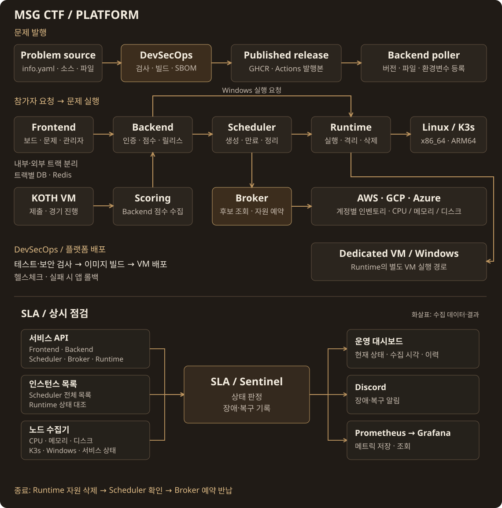

<h1>MSG CTF · DevSecOps</h1>

프론트·백엔드의 빌드·보안 검사·VM 자동 배포를 담당하는 공통 워크플로

<a href="https://msg-ctf.github.io/platform.html">플랫폼</a> · <a href="#development">개발 문서</a> · <a href="https://github.com/MSG-CTF/jm_devsecops/tree/main">실행 코드 (main)</a>

<h2 align="center">Overview</h2>

| 담당 저장소 | 구현 |
| --- | --- |
| [**Challenge pipeline**](https://github.com/MSG-CTF/msgctf-devsecops) | info.yaml 검증 → 이미지 빌드·Trivy·Gitleaks → GHCR·SBOM·발행본 제공 |
| [**Platform pipeline**](https://github.com/MSG-CTF/jm_devsecops/tree/main) | 테스트·보안 검사 → 이미지 빌드 → VM 배포·헬스체크·앱 롤백 |

배포할 커밋을 고정하고, DB 백업·마이그레이션과 새 앱의 응답을 확인한 뒤 전환합니다
실패하면 앱을 이전 버전으로 돌리며, DB 복구는 백업을 기준으로 별도 처리합니다

[VM 자동 배포](https://github.com/MSG-CTF/jm_devsecops/blob/main/docs/development-vm-auto-deploy.md) · [플랫폼 흐름 보기](https://msg-ctf.github.io/platform.html#architecture)

<h2 align="center">Contributors</h2>

<table align="center">
<tr><th align="center" colspan="8"><a href="https://github.com/MSG-CTF/jm_devsecops/tree/main">DevSecOps</a></th><th align="center" colspan="4"><a href="https://github.com/MSG-CTF">PM</a></th></tr>
<tr>
<td align="center" valign="top" colspan="4" width="260"> <a href="https://github.com/woalseee"><b>woalseee</b></a> 플랫폼 CI · VM 배포 배포 파일·스토리지</td>
<td align="center" valign="top" colspan="4" width="260"> <a href="https://github.com/Giheon-Jeon"><b>Giheon-Jeon</b></a> 프론트 검사 Semgrep 규칙 수정</td>
<td align="center" valign="top" colspan="4" width="260"> <a href="https://github.com/jongcoding"><b>jongcoding</b></a> 배포 전환·롤백 제한 SSH · 키·백업 연결</td>
</tr>
</table>

기여 기록 · 관련 PR

| 기여자 | 기여 내용 | 관련 PR |
| --- | --- | --- |
| [woalseee](https://github.com/woalseee) | 공통 플랫폼 CI와 개발 VM 배포, 배포 파일·스토리지 관리 | [#8](https://github.com/MSG-CTF/jm_devsecops/pull/8) · [#10](https://github.com/MSG-CTF/jm_devsecops/pull/10) · [#12](https://github.com/MSG-CTF/jm_devsecops/pull/12) |
| [Giheon-Jeon](https://github.com/Giheon-Jeon) | 프론트 검사에 맞춘 Semgrep 규칙 수정 | [#7](https://github.com/MSG-CTF/jm_devsecops/pull/7) |
| [jongcoding](https://github.com/jongcoding) | 배포 전환·롤백, 프론트 제한 SSH 배포와 보안 키·백업 연동 | [#13](https://github.com/MSG-CTF/jm_devsecops/pull/13) · [#14](https://github.com/MSG-CTF/jm_devsecops/pull/14) · [#16](https://github.com/MSG-CTF/jm_devsecops/pull/16) |

<h2 align="center">Tech Stack</h2>

 &nbsp;  &nbsp;  &nbsp;  GitHub Actions · Docker · Trivy · Nginx Python · PostgreSQL · Redis · Semgrep · Bandit · Gitleaks

## Development

- [개발 VM 자동 배포](https://github.com/MSG-CTF/jm_devsecops/blob/main/docs/development-vm-auto-deploy.md)
- [백엔드 배포 전환](https://github.com/MSG-CTF/jm_devsecops/blob/main/docs/backend-deployment-availability.md)
- [검사·배포 실행 안내](https://github.com/MSG-CTF/jm_devsecops/blob/main/docs/devsecops-runbook.md)

<a href="https://github.com/MSG-CTF/msg-ctf.github.io/blob/67e93a09ce630910f98ae56fb118ca1317af78e0/docs/tech-icons.md">아이콘 출처</a>

